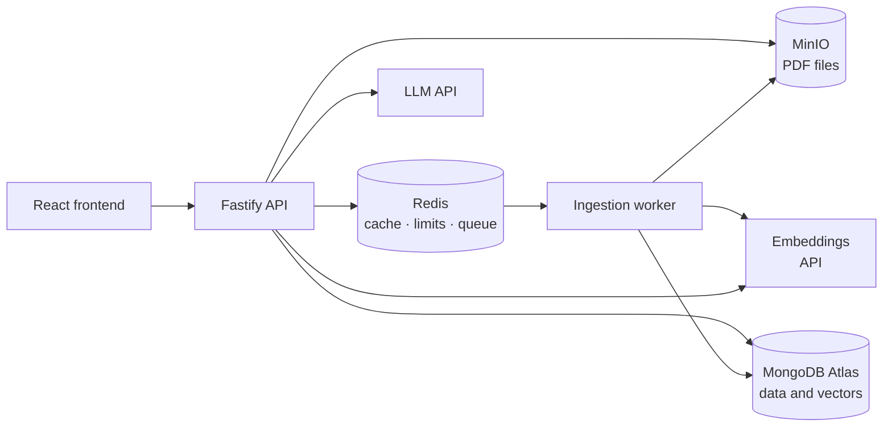

# DocQA

A RAG assistant for your documents: upload a PDF, ask it questions in plain language, and get answers cited by document and page.

## Status

End-to-end working MVP: sign-up and login, PDF upload with background processing, questions over one or several documents with cited answers (click a citation to see the source passage), conversation history, response caching and a per-minute question limit. Still pending: the demo GIF and choosing where to host a public demo.

## Requirements

The full requirements spec lives in [REQUIREMENTS.md](./REQUIREMENTS.md) (in Spanish).

## Architecture



The system runs two decoupled flows:

- **Question flow**: the API checks the Redis cache first. On a miss, it embeds the question with Voyage AI and runs a vector search in MongoDB Atlas to retrieve the 5 most similar chunks. It then builds an LLM prompt that strictly separates system instructions from the retrieved document text, sends it to Groq, and stores the answer with its exact citations (document and page), returning it with an `X-Cache` header.
- **Ingestion flow**: once an uploaded PDF passes structural validation, the API stores it in MinIO and enqueues a BullMQ job (on Redis). The ingestion worker picks it up asynchronously, extracts text page by page, splits it into chunks (~800 tokens with 100 overlap), embeds them with Voyage AI and saves chunks and vectors to MongoDB Atlas.

Isolation between users and documents (NFR-01) is enforced by the database itself: `userId` and `documentId` are declared as `filter` fields inside the vector index definition (`chunks_vector_index`), so they are applied inside the search rather than as an application-level post-filter.

## Stack

- **Frontend**: React 19.0.0, Vite 6.0.11, TanStack Query 5.65.1, TanStack Router 1.98.6, Tailwind CSS 4.0.3.
- **API**: Node.js 20.18.0, Fastify 5.2.1, TypeScript 5.7.3, Zod 3.24.1, BullMQ 5.34.6, ioredis 5.4.2, MongoDB driver 6.21.0, MinIO client 8.0.7, pdf-lib 1.17.1, @node-rs/argon2 2.2.1, @fastify/jwt 10.2.2, @fastify/cors 11.3.0, @fastify/helmet 13.1.1.
- **Ingestion worker**: BullMQ 5.34.6, ioredis 5.4.2, MongoDB driver 6.21.0, MinIO client 8.0.7, unpdf 1.8.1 (text extraction), pdf-lib 1.17.1 (structural validation).
- **Embeddings and LLM**: Voyage AI (`voyage-3-lite`, 512 dimensions), Groq (`openai/gpt-oss-120b`).
- **Infrastructure and quality**: MongoDB (`mongodb/mongodb-atlas-local:8.0.30`, with Vector Search), Redis, MinIO, Turborepo 2.4.0, Vitest 3.0.5, ESLint 9.19.0, GitHub Actions, Docker Compose, pnpm 12.3.4.

## Running it

1. **Prerequisites**: Docker and Docker Compose, Node.js 20.18.0 (`nvm use`, see `.nvmrc`), pnpm 12.3.4 via Corepack (`corepack enable && corepack prepare pnpm@12.3.4 --activate`), plus a Voyage AI API key and a Groq API key.
2. **Environment variables**:
   ```bash
   cp .env.example .env
   ```
   Fill in `VOYAGE_API_KEY` and `GROQ_API_KEY`, and generate `JWT_SECRET` (e.g. `openssl rand -base64 48`, as `.env.example` suggests).
3. **Infrastructure** (MongoDB with Vector Search, Redis and MinIO; not the apps, see the note below):
   ```bash
   docker compose up -d
   ```
4. **Dependencies**:
   ```bash
   pnpm install
   ```
5. **Apps in development** (API, worker and frontend in parallel via Turborepo):
   ```bash
   pnpm dev
   ```
6. **URLs**: API at [http://localhost:3000](http://localhost:3000), frontend at [http://localhost:5173](http://localhost:5173), MinIO console at [http://localhost:9001](http://localhost:9001) (user and password from `MINIO_ROOT_USER`/`MINIO_ROOT_PASSWORD` in your `.env`).
7. **Quality and tests**:
   ```bash
   pnpm lint
   pnpm typecheck
   pnpm test
   pnpm test:coverage
   ```
   Integration tests (need MongoDB running):
   ```bash
   pnpm --filter @docqa/api test:integration
   pnpm --filter @docqa/worker test:integration
   ```

> `docker compose up` starts only the infrastructure (MongoDB, Redis, MinIO); `pnpm dev` starts the three apps on top of it. It's two commands, not one. See the decision recorded in [REQUIREMENTS.md, section 10](./REQUIREMENTS.md#10-riesgos-y-decisiones-abiertas).

## Technical decisions

**Authentication (FR-01)**

- The refresh token is a random **opaque** value, not a JWT: its state lives in MongoDB anyway, so a JWT would add a second source of truth that can contradict the first. Only its SHA-256 hash is stored, never the token. SHA-256 rather than Argon2, because with 256 bits of entropy there's no dictionary to attack; Argon2 is for low-entropy, human-chosen secrets.
- Every refresh **rotates** the token: the used one becomes invalid and a new one is issued with the same `familyId`. Reusing an already-rotated token is treated as theft and revokes the whole family, not just that token. Known trade-off: two tabs refreshing at the exact same moment also kill the family (`replacedByHash` is already in the schema to add a grace window later without a data migration).
- `db/indexes.ts` creates indexes with `createIndex` at startup, which is idempotent unless an existing index's options change. Good enough at this size; in production it would be a versioned migration.

**Documents (FR-02, FR-04)**

- Real structural validation: neither the client's `Content-Type` nor the file extension is trusted. Magic bytes (`%PDF-`) are checked to fail fast, then the full structure is loaded with `pdf-lib` (rejecting corrupt or encrypted files) before anything is stored or queued.
- Isolation at the database level (NFR-01): `findById` and document queries filter by `_id` and `userId` in the same MongoDB predicate, so no query can return another user's data, and the API answers 404 without revealing whether the ID exists in another account.
- Random storage keys (`${userId}/${uuid}.pdf`): the MinIO object name is decoupled from the original file name, avoiding collisions and path traversal.
- Persistence order without compensation: the blob is stored in MinIO before the MongoDB record is inserted. If the insert or the enqueue fails, what's left is a harmless orphan blob in MinIO rather than a broken database record, without over-engineering a rollback.

**Embeddings (Voyage AI)**

- `voyage-3-lite`, 512 dimensions, via the Voyage AI API.
- Why: its free tier is generous, so a public demo works without asking anyone for a credit card; and 512-dimension vectors weigh less in the vector index than OpenAI's default 1536, which helps stay within MongoDB Atlas free-tier limits.
- The model is set in `EMBEDDINGS_MODEL`. Changing it changes the index dimensions and requires re-embedding existing chunks.

**Generation (Groq · GPT-OSS 120B)**

- `openai/gpt-oss-120b` via the Groq API (OpenAI-compatible chat completions contract), called over plain HTTP from `apps/api` (no SDK), like every other external integration in the project.
- Why: the provider changed three times. It went from Claude to Gemini (preference for its SDK/API), but the Gemini key landed on the developer API's free tier (separate from the consumer "Google AI Pro" subscription) and kept returning 503 "high demand" on two different models. OpenRouter came next, but three different `:free` models returned the same 404 "unavailable for free" even though the daily quota was untouched (confirmed with `GET /api/v1/key`), pointing to an account-level block rather than an exhausted model. Groq won: its free tier uses per-model rate limits instead of credits, with no card or verification. Full decision recorded on 2026-09-28 in [REQUIREMENTS.md, section 10](./REQUIREMENTS.md#10-riesgos-y-decisiones-abiertas).
- Each switch only touched the adapter (`apps/api/src/modules/llm/repositories/groq-llm.provider.ts`). The `LlmProvider` port and the rest of the RAG flow (prompt, data/instruction separation from NFR-05, citations) never changed. That's the payoff of keeping the provider behind an interface.
- The model is set in `GROQ_MODEL` and the key in `GROQ_API_KEY`.

**MongoDB Atlas Vector Search**

- The vector index on `chunks` (`chunks_vector_index`) is created idempotently when the worker starts (`ensureChunksVectorIndex`): if it already exists, nothing fails.
- Per-user and per-document isolation (NFR-01) is not an application post-filter: `userId` and `documentId` are declared as `filter` fields in the index definition, and `$vectorSearch` applies them before computing similarity, not after.
- `numCandidates` is set to ≈20× the requested `limit` (Atlas's recommendation for good recall without hurting latency), capped at 10,000.

**Response cache (NFR-09)**: implemented

- Key: SHA-256 of `userId:sorted-documentIds:normalized-question:generation`, where the question is normalized with trim, lowercase and whitespace collapsing (`apps/api/src/modules/cache/utils/cache-key.ts`).
- TTL: 24 hours (`CACHE_TTL_SECONDS`, in `apps/api/src/modules/cache/repositories/redis-response-cache.ts`).
- Invalidation without `SCAN`/mass `DEL`: a per-user "generation" counter in Redis (`cache:gen:<userId>`) is bumped with `INCR` whenever a document is uploaded or deleted (`DocumentService`). Since the generation is part of the key, that implicitly invalidates every cached answer for that user.
- The `X-Cache` header (`HIT`/`MISS`) is exposed on `POST /conversations/:id/messages`.

**Rate limiting (NFR-04)**: implemented

- 20 questions per minute per user (`RATE_LIMIT_QUESTIONS_PER_MINUTE`), applied only to `POST /conversations/:id/messages`, because NFR-04 limits questions, not requests in general. Over the limit, the API returns 429 with code `RATE_LIMIT_EXCEEDED` and a `Retry-After` header.
- 60 s fixed window in Redis: `INCR` on `ratelimit:question:<userId>` and `EXPIRE ... NX` in the same `MULTI` transaction, so the first attempt opens the window and later bursts don't extend it (`apps/api/src/modules/rate-limit/repositories/redis-rate-limiter.ts`).
- Custom code instead of `@fastify/rate-limit`: the key is the token's `userId`, which only exists after `authenticate`, so the limiter runs as a `preHandler` right after authentication, and the counter lives in the same Redis as the cache and the queue.
- Cached answers count too: the limit protects both LLM cost and the endpoint against abuse.
- Known trade-off: with a fixed window a user can fire up to 40 questions within a few seconds around the window boundary. Acceptable for a demo; a sliding window (sorted set) would prevent it at the cost of more writes.

**API costs**

- Generation runs on Groq's free tier (`openai/gpt-oss-120b`), which uses daily per-model rate limits instead of credits.
- A spending limit is configured directly on the Voyage AI account (outside the repo).
- The Redis response cache (NFR-09) cuts repeated calls to the LLM and the embeddings service.

**CI (NFR-12)**

- Two parallel jobs: `checks` (lint, types, unit tests and domain coverage in `api`) needs no external services and gives feedback in seconds; `integration` spins up a MongoDB container only for the tests that need it (`test:integration`), without slowing the first job.
- The 80% coverage target (NFR-11) is checked by a separate script, `test:coverage`, instead of being forced into the regular `test`, so iterating locally with `pnpm test` doesn't pay for coverage instrumentation on every run.

## Demo

GIF still to be recorded. The full flow already works in the UI (upload a PDF, wait until it's "ready", ask a question and open a citation), so you can reproduce it locally by following "Running it".

## How AI was used in development

- **Spec-driven development**: architecture, data modeling and implementation start from [REQUIREMENTS.md](./REQUIREMENTS.md) (what to build and why) and [CLAUDE.md](./CLAUDE.md) (conventions and permanent repo context), with Claude Code as the main development assistant.
- **Multi-agent orchestration with adversarial review**: several tasks in this repo were implemented by delegating the coding to an external CLI agent (Google Antigravity CLI, `agy`, on a Gemini model) orchestrated by Claude Code, with implementation plans first put through an adversarial review by another Gemini model that looks for gaps, contradictions and unverified assumptions before any code is written.
- **An honest limit**: code and docs produced by an LLM get reviewed and tested like any other change, never assumed correct because an AI wrote them. The original Spanish version of this README is an example: the first plan to write it was rejected in adversarial review because it dodged a real contradiction between `REQUIREMENTS.md` and `docker-compose.yml` about what `docker compose up` starts. The corrected plan resolved it (see section 10 of `REQUIREMENTS.md`), and the delegated agent's first draft still had a wrong detail (the MinIO console example credentials) that was caught before merging, precisely because it wasn't taken on trust.

## License

MIT
